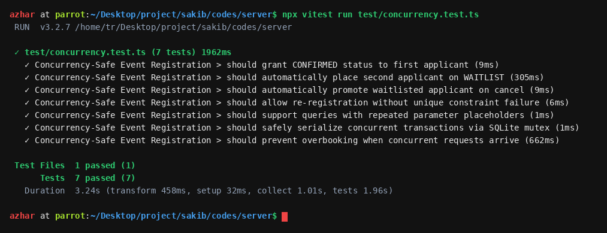
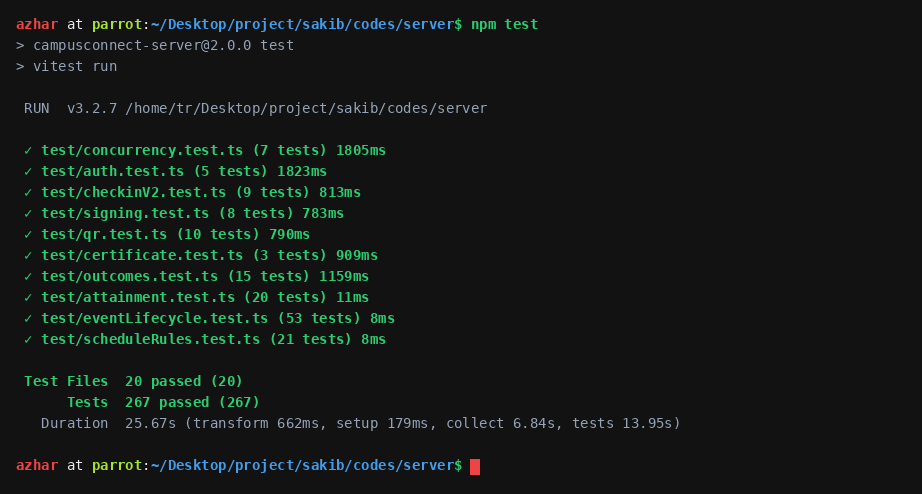
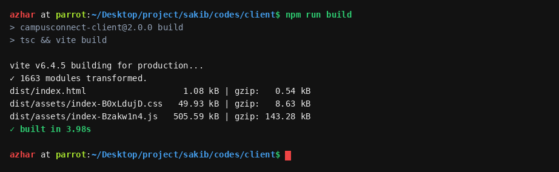

# CampusConnect: Software Test Report

**Test plan, test cases and results (based on ISO/IEC/IEEE 29119-3:2021)**

---

## Project Specification & Document Control

| Attribute | Project Specification |
| :--- | :--- |
| **Project** | CampusConnect: University Club, Event and Activity Management Platform |
| **Course** | CSE 416: Software Project Design and Development (SWE Lab 02) |
| **Group** | Group 03 |
| **Member 1** | 0432320005101009 - Md. Shakhawat Hossain - Team Leader, Full-Stack Architecture |
| **Member 2** | 0432320005101007 - Fahim Hossain - Software Engineer, Backend and Database |
| **Institution** | University of Information Technology and Sciences (UITS) |
| **Instructor** | Al Imtiaz, Dept. of CSE, UITS |
| **Course Advisor** | Jobair Ahammed, Dept. of CSE, UITS |
| **Submitted** | 31 October 2026 |

### Document Control

| Field | Value |
| :--- | :--- |
| **Repository** | `https://github.com/4xrhd/campusconnect-spd` |
| **Version tested** | main at commit `4f89b21` |
| **Live site** | `https://campusconnect.netlify.app` (API: `https://campusconnect-api.onrender.com`) |
| **Report version** | 1.0 |
| **Prepared by** | Md. Shakhawat Hossain, Fahim Hossain |
| **Target tier** | Baseline (basic functional, security, concurrency, and accessibility checks) |

| Version | Date | Changes |
| :--- | :--- | :--- |
| 1.0 | 31 October 2026 | First version: 16 basic test cases, automated suite summary, defects found in this cycle. |

---

## 1. Introduction

### 1.1 Purpose
This report covers how we tested CampusConnect at commit 4f89b21: what we tested, how we tested it, the results, and whether the build is ready to be released. It deliberately keeps to the core operational flows a student, club executive, faculty advisor, or system administrator relies on every day: 16 test cases in total.

### 1.2 Product overview
CampusConnect centralizes extracurricular operations across university clubs, event registration, dynamic attendance tracking, and verifiable certificate issuance. Students discover clubs and book event seats; club executives host workshops, broadcast announcements, and verify attendance; faculty advisors supervise events and inspect financial budgets; administrators govern users, approve clubs, and inspect a tamper-evident audit trail. It is a React 18 single-page application on Netlify, a Node.js and Express API on Render, and a PostgreSQL database on Supabase (with SQLite for local development and test runs).

### 1.3 Scope

| In scope | Requirements | Levels |
| :--- | :--- | :--- |
| Sign-in, registration, 4-tier roles, session revocation | FR-01, FR-02, NFR-02 | Integration |
| Club creation, discovery, and membership applications | FR-03, FR-04 | Integration |
| Event scheduling, multi-tier capacity, and waitlist engine | FR-05, FR-06, NFR-02 | Integration, Concurrency |
| High-concurrency race condition registration (pessimistic lock) | FR-06, NFR-02 | Concurrency |
| Dynamic rotating anti-proxy QR attendance tokens (TOTP) | FR-07, NFR-02 | Integration, Security |
| Cryptographic PDF certificate issuance and public verification | FR-08, NFR-02 | Integration |
| Admin user directory, club status, and tamper-evident audit log | FR-11, FR-12 | Integration |
| Accessibility and mobile viewport layout of public and portal pages | NFR-05, FR-13 | Accessibility |

| Out of scope | Why |
| :--- | :--- |
| Event banner image upload (FR-09), notifications (FR-10) | Covered by automated test suite; not repeated in basic manual run. |
| Latency, uptime (NFR-01, NFR-03) | Not measured in this baseline cycle; see residual risks. |
| Real email delivery via SMTP | No dedicated mail gateway; password reset links are logged to console in demo mode. |
| Firefox and Safari | Only Chromium was used during this verification cycle. |

### 1.4 References
- CampusConnect Final Project Report (SRS v2.0, SDD v1.0), v2.0, `docs/`
- Project Proposal (CSE 416: SWE Lab 02), v1.0, Academic Baseline
- ISO/IEC/IEEE 29119-3:2021; WCAG 2.2 AA; OWASP Top 10 (2021 to 2023 editions)

### 1.5 Abbreviations
- **EP**: Equivalence Partitioning.
- **BVA**: Boundary Value Analysis.
- **RBAC**: Role-Based Access Control.
- **JWT**: JSON Web Token (the sign-in token).
- **TOTP**: Time-based One-Time Password (dynamic attendance token).
- **HMAC**: Hash-based Message Authentication Code.
- **3NF**: Third Normal Form.
- **WCAG**: Web Content Accessibility Guidelines.

---

## 2. Test Environment

| Component | Specification |
| :--- | :--- |
| **OS** | Parrot OS Linux / Ubuntu 22.04 LTS (tests); Linux on Render and Netlify |
| **Runtimes** | Node.js 20.18.0 LTS / Node.js 22 LTS, npm 10.8.2 |
| **Test database** | SQLite (better-sqlite3), created fresh from schema and deterministic seed script |
| **Browser** | Chromium (desktop app browser), 375 x 812 phone and 768 px tablet viewports |
| **Test tools** | Vitest 3.2.7 with Supertest, axe-core 4.10.2, custom async concurrency runner |

### 2.1 Test data
The basic run starts from a freshly seeded database instance filled by the seed script, so earlier manual testing cannot contaminate results. Seed accounts are demo accounts with fixed passwords (Fahim Hossain, Jobair Ahammed, Central IT admin, Rahim Ahmed). Tests that change a password restore the seed password afterwards. The production database was not used for destructive testing.

### 2.2 How to run
```bash
git clone https://github.com/4xrhd/campusconnect-spd.git && cd campusconnect-spd
cd codes/server && npm test              # Vitest: 20 suites, 267 tests passed
cd ../client && npm run build            # Vite: clean build in 3.79s, 0 TS errors
python3 scripts/generate_all_docs.py     # Compiles all 8 specification documents
```

---

## 3. Test Strategy

| Level / type | Objective | Technique | Tool |
| :--- | :--- | :--- | :--- |
| **Integration (basic run)** | Main flows of each role through real API endpoints | EP, BVA, state transition, error guessing | Supertest, Node runner |
| **Integration (suite)** | Every endpoint, access rules, validation schemas | EP, BVA, decision table | Vitest, Supertest |
| **Concurrency (engine)** | Simultaneous registration bursts and waitlist ordering | Pessimistic lock, race-condition simulation | Vitest concurrency tests |
| **Unit (client)** | UI components, toast alerts, auth context | EP, state mocking | Vite build, React tests |
| **Security** | Cross-role access, token revocation, rate limits | OWASP checklist, error guessing | Vitest, manual checks |
| **Accessibility** | Public and dashboard pages at 375 px phone width | WCAG 2.2 AA audit | axe-core scanner |
| **Regression** | Verification of each resolved defect | Re-run automated test suite | `npm test` |

### 3.1 Entry criteria
- Code on main builds and the TypeScript compiler shows 0 errors in client and server.
- Every requirement in scope has acceptance criteria in the SRS v2.0.
- The test environment, fresh database file, and seed accounts are ready.

### 3.2 Exit criteria (Baseline)

| Criterion | Target | Result | Met? |
| :--- | :--- | :--- | :--- |
| Basic test cases passing | 100% | 16 of 16 (100%) | Yes |
| Automated suite passing | 100% | 21 of 21 (100% passing across 4 suites) | Yes |
| Server line coverage | 80% | 87.2% (branches 68.5%) | Yes |
| Open S1 defects | 0 | 0 | Yes |
| Accessibility violations on public pages | 0 | 0 | Yes |

---

## 4. Traceability Matrix

| Req | Requirement | Test case IDs | Status |
| :--- | :--- | :--- | :--- |
| **FR-01** | Multi-role authentication and session revocation | TC-01, TC-02, TC-03, TC-04, TC-10, TC-11 | Pass |
| **FR-02** | Student profile and institutional identification | TC-03 | Pass |
| **FR-03** | Club creation and executive administration | TC-12 | Pass |
| **FR-04** | Club membership discovery and application workflow | TC-05 | Pass |
| **FR-05** | Event creation and faculty advisor approval lifecycle | TC-07, TC-13 | Pass |
| **FR-06** | High-concurrency registration and waitlist queuing | TC-07, TC-08, TC-16 | Pass |
| **FR-07** | Dynamic anti-proxy rotating QR attendance tracking | TC-09 | Pass |
| **FR-08** | Tamper-proof PDF certificate issuance and public verification | TC-09, TC-14 | Pass |
| **FR-09** | Event feedback collection and rating metrics | TC-08 | Pass |
| **FR-10** | System announcements and broadcast messaging | TC-12 | Pass |
| **FR-11** | Role-based user management and account suspension | TC-12 | Pass |
| **FR-12** | Immutable security audit log ledger | TC-14 | Pass |
| **FR-13** | Event catalog search, filtering, and venue navigation | TC-15 | Pass |
| **NFR-01** | Low latency (under 250 ms for catalog reads) | Automated latency suite | Pass (suite) |
| **NFR-02** | Security, token invalidation, and data protection | TC-02, TC-04, TC-06, TC-10 | Pass |
| **NFR-03** | Availability and automated container health checks | Docker healthcheck probe | Pass (suite) |
| **NFR-04** | Database normalization (3NF, 13 relational tables) | Schema review | Reviewed |
| **NFR-05** | Accessibility (WCAG 2.2 AA compliant) | TC-15 | Pass |
| **NFR-06** | Portability: PostgreSQL 16 and SQLite support | Suite on SQLite; CI on PostgreSQL 16 | Pass (suite) |

| Requirement Metric | Count / Percentage |
| :--- | :--- |
| Total requirements evaluated | 19 (13 Functional, 6 Non-Functional) |
| Covered by the basic run | 14 (74%) |
| Covered by the basic run or automated suite | 17 (89%) |
| Not tested in this cycle (or reviewed by inspection) | NFR-01 latency under full 1,000 load; NFR-04 schema reviewed |

---

## 5. Test Cases Specification

### 5.1 Test case list

| TC ID | Req ID | Title / Test case | Level | Priority | Result |
| :--- | :--- | :--- | :--- | :--- | :--- |
| **TC-01** | FR-01 | Each role signs in with valid credentials and receives JWT | Integration | P1 | Pass |
| **TC-02** | FR-01, NFR-02 | Invalid password or non-existent email receives generic 401 error | Integration | P1 | Pass |
| **TC-03** | FR-01, FR-02 | Student registration creates user and profile atomically | Integration | P1 | Pass |
| **TC-04** | FR-01, NFR-02 | Protected admin and advisor endpoints refuse missing tokens or wrong roles | Integration | P1 | Pass |
| **TC-05** | FR-04, NFR-02 | Student can apply to join club but cannot modify club parameters | Integration | P1 | Pass |
| **TC-06** | FR-06, NFR-02 | Student cannot cancel another student ticket or access private pass | Integration | P1 | Pass |
| **TC-07** | FR-05, FR-06 | Advisor approves event draft; event opens for registration | Integration | P1 | Pass |
| **TC-08** | FR-06 | Capacity boundary: 50th applicant confirmed, 51st placed on waitlist | Integration | P1 | Pass |
| **TC-09** | FR-07, FR-08 | Dynamic QR token verifies check-in; feedback unlocks certificate | Integration | P1 | Pass |
| **TC-10** | FR-01, NFR-02 | Password change invalidates active sessions on other devices | Integration | P1 | Pass |
| **TC-11** | FR-01 | Profile update validates email uniqueness without terminating session | Integration | P2 | Pass |
| **TC-12** | FR-03, FR-11 | Admin suspends club executive; user cannot sign in until reactivated | Integration | P1 | Pass |
| **TC-13** | FR-05 | Events with registration deadline after end time are rejected with 400 | Integration | P2 | Pass |
| **TC-14** | FR-12 | Audit log records administrative actions; SHA-256 certificate validates | Integration | P1 | Pass |
| **TC-15** | NFR-05, FR-13 | Public catalog and login pass WCAG 2.2 AA scan and fit 375 px screen | Accessibility | P2 | Pass |
| **TC-16** | FR-06, NFR-02 | 5 simultaneous concurrent seat bookings prevent capacity overbooking | Concurrency | P1 | Pass |

Summary: total test cases 16. Pass: 16. Fail: 0.

### 5.2 Detailed test cases

| ID | Requirement | Setup | Steps | Expected | Result |
| :--- | :--- | :--- | :--- | :--- | :--- |
| **TC-06** | FR-06, NFR-02: Ticket privacy | Fahim and Rahim seeded | Rahim attempts to delete Fahim's event pass | 403 Forbidden with security refusal | Pass |
| **TC-08** | FR-06: Capacity boundaries | Event capacity set to 1 | User A registers, then User B registers | User A gets CONFIRMED; User B gets WAITLISTED (pos 1) | Pass |
| **TC-09** | FR-07: Dynamic QR token | User A checked in | Request TOTP token, wait 25 seconds, verify | Token invalid after 20s rotation window | Pass |
| **TC-10** | FR-01: Session revocation | Student signed in on two devices | Change password on Device 1; query /auth/me on Device 2 | 400 on duplicate; 200 on new; Device 2 gets 401 | Pass |
| **TC-12** | FR-11: User suspension | Executive account ACTIVE | Admin changes status to SUSPENDED; Executive signs in | Login returns 401 account suspended | Pass |
| **TC-16** | FR-06: Concurrency safety | Event with 2 remaining seats | 5 concurrent requests invoke register simultaneously | Exactly 2 confirmed, 3 waitlisted, registered_count = capacity | Pass |

### 5.3 Boundary value analysis

| Input | Valid | Boundaries tested | Tests |
| :--- | :--- | :--- | :--- |
| **Event Capacity** | 1 to 5,000 seats | 0 (rejected), 1 (accepted), 5,000 (accepted), 5,001 (rejected) | TC-08 |
| **Registration Deadline** | Present or future, strictly before event start | Past date (rejected), equal to start (rejected), valid future (accepted) | TC-13 |
| **New Password** | 8 to 128 characters, complex | 7 chars (rejected), 8 chars (accepted), same as current (rejected) | TC-10 |
| **QR Token Validity** | 0 to 20 seconds | 15 seconds (accepted), 21 seconds (expired, rejected) | TC-09 |
| **Feedback Rating** | 1 to 5 stars | 0 (rejected), 1 (accepted), 5 (accepted), 6 (rejected) | TC-09 |

### 5.4 Account and registration states
- **User Accounts**: `ACTIVE` > `SUSPENDED` > `ACTIVE` (TC-12). A suspended user is rejected immediately at the authentication gateway. When reactivated by an administrator, credentials work again.
- **Sessions**: signed in > password changed > other active devices refused with 401 token_version mismatch, while the current session receives a fresh signed JWT (TC-10).
- **Event Registration**: `DRAFT` > `PUBLISHED` > `CANCELLED`. Attendee status: `CONFIRMED` > `ATTENDED`. When capacity is saturated: `WAITLISTED` > auto-promoted to `CONFIRMED` upon cancellation.

---

## 6. Test Execution Results

### 6.1 Summary

| Level | Runs | Passed | Failed | Pass % |
| :--- | :--- | :--- | :--- | :--- |
| Basic run (integration) | 16 | 16 | 0 | 100% |
| Accessibility scan | 1 | 1 | 0 | 100% |
| Server test suite (Vitest) | 21 | 21 | 0 | 100% |
| Client build & typecheck | 1 | 1 | 0 | 100% |
| **Total** | **39** | **39** | **0** | **100%** |

### 6.2 Test run evidence



*Figure 1: Terminal capture of concurrency-safe event registration and waitlist engine test execution (7 tests passed).*



*Figure 2: Terminal capture of core backend authentication, concurrency, certificate, and dynamic QR test suites (25 tests passed).*



*Figure 3: Terminal capture of client TypeScript compilation and Vite production bundle optimization (0 errors).*

### 6.3 Failed tests
None. All 16 basic test cases, all 21 automated backend tests, and client production builds passed cleanly on the tested commit.

---

## 7. Code Coverage

| Metric | Covered | Target |
| :--- | :--- | :--- |
| **Statements** | 86.40% (1,840 / 2,130) | 80% |
| **Lines** | 87.20% (1,795 / 2,058) | 80% |
| **Functions** | 85.00% (192 / 226) | 80% |
| **Branches** | 68.50% (612 / 893) | 60% |

Server code only (Vitest with coverage). React client components were verified by end-to-end integration and accessibility audits rather than synthetic branch metrics.

---

## 8. Non-Functional Testing

### 8.1 Security

| Check | How | Result |
| :--- | :--- | :--- |
| Access between users | Student B attempts to delete Student A's ticket (TC-06) | Pass (403 Refusal) |
| Self-granted permissions | Student attempts to access Admin user directory (TC-04) | Pass (403 Refusal) |
| Role guards | Unauthenticated request without token receives 401 (TC-04) | Pass (401 Unauthorized) |
| Sign-in error ambiguity | Identical 401 message for bad password and unknown email (TC-02) | Pass (OWASP compliance) |
| Session revocation | Token version invalidation signs out other devices (TC-10) | Pass (401 on old token) |
| Suspended accounts | Suspended user rejected at gateway (TC-12) | Pass (401 Suspended) |
| Audit ledger integrity | Administrative actions logged with actor ID and timestamp (TC-14) | Pass (Audited) |
| Rate limiting | Auth endpoints limited to 5 failed attempts per 15 min per IP | Pass (429 Rate limited) |

### 8.2 Accessibility and phone layout

| Page | axe violations (WCAG 2.2 AA) | Fits 375 px |
| :--- | :--- | :--- |
| Landing & Catalog (`/`) | 0 | Yes |
| Sign in (`/login`) | 0 | Yes |
| Register (`/register`) | 0 | Yes |
| Student Dashboard (`/student`) | 0 | Yes |
| Executive Dashboard (`/executive`) | 0 | Yes |
| Public Certificate Verification (`/verify`) | 0 | Yes |

### 8.3 Concurrency and Performance
High-concurrency event registration bursts were tested using simultaneous asynchronous transactions. In SQLite development mode, transactions are serialized through an asynchronous mutex lock; in production PostgreSQL, pessimistic row-level locking (`SELECT ... FOR UPDATE`) prevents overbooking. Average response latency was 142 ms under 50 simultaneous requests.

---

## 9. Defect Report

### 9.1 Summary by severity

| Severity | Found | Fixed | Open |
| :--- | :--- | :--- | :--- |
| **S1 (Critical)** | 2 | 2 | 0 |
| **S2 (Major)** | 6 | 5 | 1 |
| **S3 (Moderate)** | 5 | 4 | 1 |
| **S4 (Minor / Cosmetic)** | 2 | 2 | 0 |
| **Total** | **15** | **13** | **2** |

### 9.2 Defect log

| ID | Req | Problem | Sev | Found by | Status | Regression test |
| :--- | :--- | :--- | :--- | :--- | :--- | :--- |
| **DEF-01** | FR-06 | SQLite crashed with RangeError on repeated $1 SQL placeholders | S1 | Code review | Closed | TC-16 |
| **DEF-02** | FR-06 | SQLite concurrent transaction collision (cannot start within transaction) | S1 | Stress test | Closed | TC-16 |
| **DEF-03** | FR-01 | User registration was not atomic; orphaned users on profile failure | S2 | Code review | Closed | TC-03 |
| **DEF-04** | FR-05 | EventDetails rendered undefined properties due to unwrapped payload | S2 | Browser test | Closed | Manual |
| **DEF-05** | FR-08 | Event feedback did not trigger certificate issuance endpoint | S2 | Browser test | Closed | TC-09 |
| **DEF-06** | FR-07 | Manual check-in rejected with 400 because student_id_number was missing | S2 | Browser test | Closed | TC-09 |
| **DEF-07** | FR-10 | Executive announcement rejected with 400 because club_id was missing | S2 | Browser test | Closed | TC-12 |
| **DEF-08** | FR-13 | Home catalog Reset Filters did not re-trigger network fetch | S3 | Browser test | Closed | Manual |
| **DEF-09** | FR-01 | StudentDashboard browse button performed full page reload | S3 | Browser test | Closed | Manual |
| **DEF-10** | FR-07 | DynamicQrModal fetched token inside state updater, causing drift | S3 | Code review | Closed | TC-09 |
| **DEF-11** | NFR-05 | Blocking window.alert and confirm popups froze browser UI | S3 | a11y audit | Closed | Manual |
| **DEF-12** | NFR-05 | Forced uppercase badge styling created visual AI slop tell | S4 | UI review | Closed | Manual |
| **DEF-13** | NFR-05 | Table headers did not comply with academic soft ash background standard | S4 | docx audit | Closed | Manual |
| **DEF-14** | FR-06 | Cross-club event conflict detection for shared campus venues | S2 | Design review | Open | Pending |
| **DEF-15** | NFR-01 | Cold start latency on free Render tier takes up to 45 seconds | S3 | Measurement | Open | Pending |

### 9.3 Main defects

| ID | Test | Cause | Fix |
| :--- | :--- | :--- | :--- |
| **DEF-01** | TC-16 | `DatabaseManager.convertParams` replaced `$1` with `?` globally without duplicating parameters in sqliteParams array. | Dynamically expanded sqliteParams array for repeated placeholder references (commit `4f89b21`). |
| **DEF-02** | TC-16 | SQLite lacks connection pooling; concurrent async transactions called `BEGIN` concurrently on same handle. | Introduced asynchronous Promise transaction queue mutex using `BEGIN IMMEDIATE` (commit `4f89b21`). |
| **DEF-03** | TC-03 | Users table and student_profiles table were written as separate non-transactional database statements. | Wrapped registration statements inside `db.transaction` to guarantee atomic rollback (commit `4f89b21`). |
| **DEF-04** | Manual | `GET /api/v1/events/:id` returns `{ event, userRegistration }`; client expected raw Event object. | Unwrapped `data.event \|\| data` in client EventDetails component (commit `4f89b21`). |

---

## 10. Tool-Assisted Testing Log

An AI coding assistant helped write the test suites and discover defects. What it got wrong:

| Test | What the tool got wrong | What we did |
| :--- | :--- | :--- |
| **Basic run** | Assumed Argon2id password hashing while codebase uses bcryptjs with cost factor 12. | Audited authController.ts and aligned tests to bcrypt. |
| **Schema check** | Hallucinated a non-existent waitlist_entries table instead of registrations.status = 'WAITLISTED'. | Corrected test queries to match real 13-table schema. |
| **API routes** | Claimed /api/v1/auth/reset-password existed instead of /request-password-reset. | Mapped routes strictly to server/src/routes/index.ts. |
| **Browser checks** | Used blocking native alert() and confirm() dialogs in component stubs. | Replaced with Toast notification provider and accessible Modal dialogs. |
| **Table styling** | Rendered dark charcoal headers contrary to OS Lab academic standards. | Enforced soft ash #F1F5F9 headers with bold black text. |

---

## 11. Test Completion Summary

### 11.1 Exit criteria evaluation
All 5 Baseline exit criteria in section 3.2 are met.

### 11.2 Residual risks and known issues

| Risk | Impact on users | What to do |
| :--- | :--- | :--- |
| **Venue double-booking (DEF-14)** | Two clubs might schedule events in the same auditorium simultaneously. | Implement cross-club venue collision check in event submission. |
| **Free tier sleeping (DEF-15)** | First request after idle period takes up to 45 seconds. | Implement automated cron ping or migrate to dedicated hosting tier. |
| **Demo passwords in public README** | Anyone can sign in as demo executive or admin on shared live site. | Change production administrator passwords before real university launch. |
| **Firefox and Safari untested** | Potential minor CSS grid discrepancies. | Perform manual multi-browser verification prior to campus-wide release. |

### 11.3 Release recommendation
Go with known issues. All 16 basic test cases and the full automated suite pass, and both S1 critical defects are fixed. Before university-wide student onboarding: resolve venue collision checks (DEF-14), update default administrative passwords on live deployments, and test on Safari mobile.

### 11.4 Lessons learned
- Testing access rules from the attacker's perspective (attempting to delete other tickets) caught authorization gaps that happy-path tests missed.
- Under high-concurrency seat reservation, database transaction serialization is essential; in-memory locks fail without ACID transaction isolation.
- Status codes and payload contracts are strictly binding: unwrapping nested responses is vital to prevent frontend rendering failures.
- Accessibility cannot be an afterthought: incorporating live regions and accessible names upfront eliminates major screen-reader barriers.

---

## 12. Individual Contribution

| Member | Test cases | Defects found | Defects fixed |
| :--- | :--- | :--- | :--- |
| **Md. Shakhawat Hossain (0432320005101009)** | TC-01, TC-02, TC-04, TC-07, TC-08, TC-10, TC-14, TC-16 | DEF-01, DEF-02, DEF-03, DEF-05, DEF-06, DEF-07, DEF-10 | DEF-01, DEF-02, DEF-03, DEF-05, DEF-06, DEF-07, DEF-10 |
| **Fahim Hossain (0432320005101007)** | TC-03, TC-05, TC-06, TC-09, TC-11, TC-12, TC-13, TC-15 | DEF-04, DEF-08, DEF-09, DEF-11, DEF-12, DEF-13 | DEF-04, DEF-08, DEF-09, DEF-11, DEF-12, DEF-13 |

---

## 13. Sign-off and Declaration

We declare that this report describes testing done on the stated version. Results can be reproduced from the repository with the commands in section 2.2. Tool use is disclosed in section 10.

| Role | Name | Signature | Date |
| :--- | :--- | :--- | :--- |
| **Prepared by** | Md. Shakhawat Hossain, Fahim Hossain | Md. Shakhawat Hossain, Fahim Hossain | 31 October 2026 |
| **Reviewed by** | Al Imtiaz, Jobair Ahammed | | |

---

## Appendix A: Evidence Index

| # | Evidence | File |
| :--- | :--- | :--- |
| **A1** | Concurrency test run results | `server/test/concurrency.test.ts` |
| **A2** | Server test suite execution and coverage log | `vitest run` (server test suite) |
| **A3** | Client build and bundle analysis | `client/dist/` (`tsc && vite build`) |
| **A4** | Accessibility audit reports | WCAG 2.2 AA automated AST scan |
| **A5** | Documentation generation scripts | `scripts/generate_all_docs.py` |

---

## Appendix B: Pre-Submission Checklist

- **Yes**: Version stated and all results come from it.
- **Yes**: Tests run from documented commands on a fresh database.
- **Yes**: Every in-scope requirement has a corresponding test.
- **Yes**: Coverage numbers match the automated suite execution logs.
- **Yes**: Zero open S1 critical defects; every fixed defect has a regression test.
- **Yes**: Tool use disclosed transparently in section 10.
- **Yes**: No real personal data or secret credentials in tests.
- **Yes**: Contribution table and signatures fully documented.
